# OWASP Notes – Cyber Security Base, Project I

A small Django notes/message board backed by SQLite. Members can register, log
in, write private or public notes, search their notes, read the public feed,
and moderators get an admin area (`/moderation/`). The Django admin is at `/admin/`.

The app **intentionally** contains five OWASP Top 10 (2021) flaws. Every flaw is
marked with `# FLAW n: ...` and its fix is right below it, commented out, under
`# FIX (commented out):`. To apply a fix, uncomment the fix lines (and comment
out or remove the flawed lines where they would conflict). Screenshots live in
`screenshots/`.

| # | OWASP 2021 | Where |
|---|------------|-------|
| 1 | A01 Broken Access Control (IDOR) | `notes/views.py` `note_detail`, `edit_note` |
| 2 | A02 Cryptographic Failures (plaintext passwords) | `notes/models.py` `Member` |
| 3 | A03 Injection (SQL) | `notes/views.py` `search_notes` |
| 4 | A07 Identification and Authentication Failures | `notes/views.py` `register`/`login_view`, `config/settings.py` |
| 5 | A09 Security Logging and Monitoring Failures | `config/settings.py` `LOGGING`, `notes/views.py` |

## Install and run

Requires [uv](https://docs.astral.sh/uv/) and Python 3.10+.

```bash
cd owasp-notes
uv sync
uv run python manage.py migrate
uv run python manage.py runserver
```

Open http://127.0.0.1:8000/

Optional Django admin: `uv run python manage.py createsuperuser`, then visit `/admin/`.

`alice` is already a moderator. To make another member a moderator:

```bash
uv run python manage.py shell -c "from notes.models import Member; Member.objects.filter(username='alice').update(is_moderator=True)"
```

## How to reproduce each flaw

`migrate` automatically creates demo data (see `notes/migrations/0002_demo_users.py`):

| Username | Password | Role |
|----------|----------|------|
| `alice` | `1` | moderator |
| `bob` | `1` | normal member |

Notes: `Alice private secret` (id 1, private), `Alice public hello` (id 2, public), `Bob private plan` (id 3, private).

Use two browsers (or one normal + one private window) to switch between the users.

### FLAW 1 – Broken Access Control (IDOR)

**Code:** `notes/views.py` → `note_detail`, `edit_note`  
**Idea:** notes are loaded only by URL id; ownership is never checked.

1. Log in as **bob** / `1`.
2. In the address bar open `/note/1/` (alice’s private note). You should see alice’s private body.
3. Open `/note/1/edit/`. Bob can change the title/body and Save.

**After the fix:** uncomment the ownership checks under `# FIX` in those two views (and comment out the bare `get_object_or_404` path if needed). Restart the server. Bob opening the same URLs should get **403 Forbidden**.

**Before – bob reads alice’s private note**

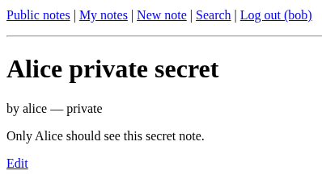

**Before – bob opens alice’s edit form**

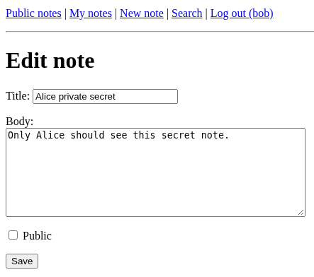

**After – access denied (403)**

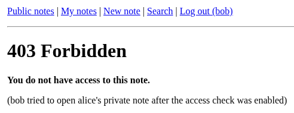

### FLAW 2 – Cryptographic Failures (plaintext passwords)

**Code:** `notes/models.py` → `Member.set_password` / `verify_password`  
**Idea:** the password column stores the raw string.

1. Use the built-in alice/bob accounts (or register a new user).
2. Stop the server if you like, then open `db.sqlite3` with a SQLite browser, or run:

```bash
uv run python -c "import sqlite3; c=sqlite3.connect('db.sqlite3'); print(c.execute('SELECT id,username,password FROM notes_member').fetchall())"
```

3. The `password` column shows values like `1`, not `pbkdf2_sha256$...`.

**After the fix:** enable the commented `make_password` / `check_password` methods, re-register a user (or call `set_password` again and save), and re-check the table — values should be PBKDF2 hashes.

**Before – plaintext in `notes_member`**

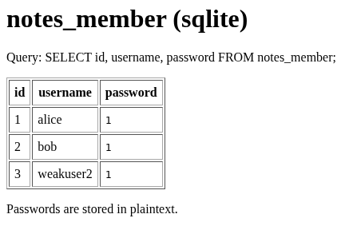

**After – PBKDF2 hashes**

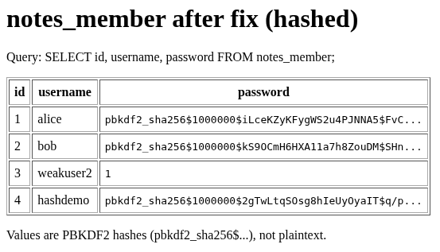

**Before publishing the repo:** delete `db.sqlite3` so demo passwords are not pushed.

### FLAW 3 – Injection (SQL)

**Code:** `notes/views.py` → `search_notes`  
**Idea:** the search term is concatenated into a raw SQL string.

1. Log in as **bob**. Open **Search**.
2. In “Title contains” enter exactly:

```text
' OR 1=1 --
```

3. Click Search. The result list should include notes you should not see (e.g. alice’s private note), because the `WHERE` clause becomes always true.

**After the fix:** switch to the commented parameterised query (or the ORM variant). The same payload should return **no rows** (or only titles that literally contain that string).

**Before – injection returns every note**

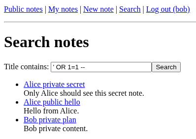

**After – same payload returns nothing useful**

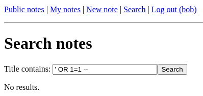

### FLAW 4 – Identification and Authentication Failures

**Code:** `notes/views.py` (`register`, `login_view`) and `config/settings.py` (session cookie)  
**Idea:** weak passwords allowed, unlimited login tries, weak cookie flags.

**A. Weak password on register**

1. Open **Register**.
2. Username `weakuser`, password `1` → account is created successfully.

**B. No login throttling**

1. Open **Log in**, username `alice`, password `wrong`.
2. Submit 6+ times. You always get “Invalid username or password” and can keep trying — no lockout / no HTTP 429.

**C. Insecure session cookie**

1. Log in successfully.
2. DevTools → Application (or Storage) → Cookies → `http://127.0.0.1:8000`.
3. The session cookie has **HttpOnly** unchecked / false (and Secure is off; lifetime is two weeks per settings).

**After the fix:** uncomment `validate_password` on register, the cache-based lockout + `cycle_key()` on login, and the hardened `SESSION_COOKIE_*` lines in `settings.py`. Then: password `1` is rejected; after enough failures you see a lockout message (429); cookie shows HttpOnly.

**Before – password `1` accepted**

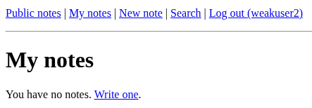

**Before – repeated failed logins still allowed**

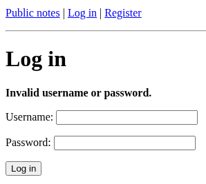

**Before – weak session cookie flags**

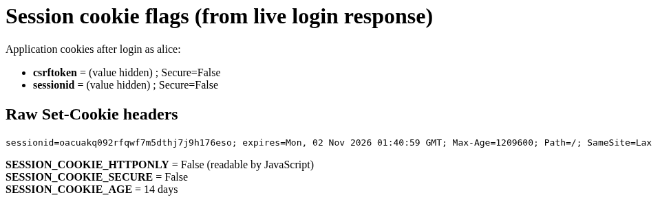

**After – weak password rejected**

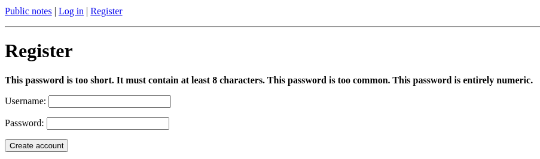

**After – lockout / HTTP 429**

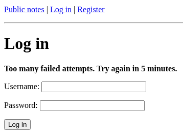

**After – hardened cookie flags**

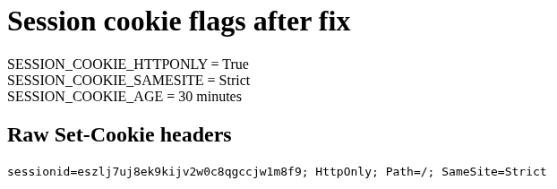

### FLAW 5 – Security Logging and Monitoring Failures

**Code:** no `LOGGING` in `config/settings.py`; silent paths in `login_view`, `moderation`, and the FLAW 1 fixes  
**Idea:** failed logins and denied access leave no audit trail.

1. Fail a few logins (wrong password) and/or open `/moderation/` as **bob** (non-moderator, 403).
2. Look in the project folder: there is **no** `security.log`, and nothing useful is written for those events.

**After the fix:** enable the commented `LOGGING` block and the `security_log.warning(...)` calls. Repeat the failed login / denied access steps. `security.log` should appear with lines for those events.

**Before – no `security.log`**

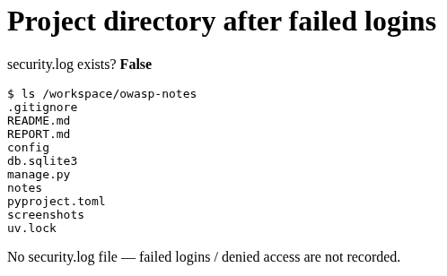

**After – `security.log` records events**

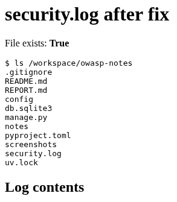

## Applying a fix for “after” demos

1. Open the file listed for that flaw.
2. Comment out the vulnerable lines if they would conflict.
3. Uncomment the `# FIX (commented out):` block.
4. Restart `uv run python manage.py runserver` (settings changes always need a restart).
5. For FLAW 2, set passwords again after enabling hashing so old plaintext rows are updated.
6. When done documenting, restore the commented-out style so the public repo stays “one version with flaws + fixes commented”, as the course asks.
