# OWASP Notes – Cyber Security Base, Project I

A small Django notes/message board backed by SQLite. Members can register, log
in, write private or public notes, search their notes, read the public feed,
and moderators get an admin area (`/moderation/`). The Django admin is at `/admin/`.

The app **intentionally** contains five OWASP Top 10 (2021) flaws. Every flaw is
marked with `# FLAW n: ...` and its fix is right below it, commented out, under
`# FIX (commented out):`. To apply a fix, uncomment the fix lines (and comment
out or remove the flawed lines where they would conflict). Screenshots live in
`screenshots/`.

| # | OWASP 2021 | Where |
|---|------------|-------|
| 1 | A01 Broken Access Control (IDOR) | `notes/views.py` `note_detail`, `edit_note` |
| 2 | A02 Cryptographic Failures (plaintext passwords) | `notes/models.py` `Member` |
| 3 | A03 Injection (SQL) | `notes/views.py` `search_notes` |
| 4 | A07 Identification and Authentication Failures | `notes/views.py` `register`/`login_view`, `config/settings.py` |
| 5 | A09 Security Logging and Monitoring Failures | `config/settings.py` `LOGGING`, `notes/views.py` |

## Install and run

Requires Git, uv and Python 3.10+.

```bash
git clone https://github.com/wolfish1/owasp-notes.git
cd owasp-notes
uv sync
uv run python manage.py migrate
uv run python manage.py runserver
```

Open http://127.0.0.1:8000/

## How to reproduce each flaw

`migrate` automatically creates demo data:

| Username | Password | Role |
|----------|----------|------|
| `alice` | `1` | moderator |
| `bob` | `1` | normal member |

Notes: `Alice private secret` (id 1, private), `Alice public hello` (id 2, public), `Bob private plan` (id 3, private).

### FLAW 1 – Broken Access Control (IDOR)

1. Log in as **bob** / `1`.
2. In the address bar open `/note/1/` (alice’s private note). You should see alice’s private body.
3. Open `/note/1/edit/`. Bob can change the title/body and Save.

**After the fix:** As bob, `/note/1/` shows "You do not have access to this note." and `/note/1/edit/` shows "You can only edit your own notes.".

**Before – bob reads alice’s private note**

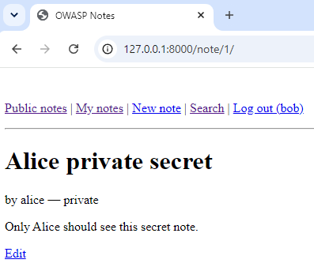

**Before – bob opens alice’s edit form**

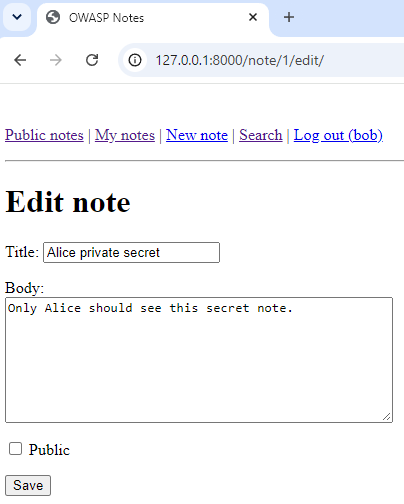

**After – bob is denied reading alice’s note**

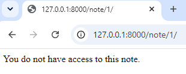

**After – bob is denied editing alice’s note**

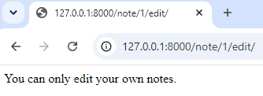

### FLAW 2 – Cryptographic Failures (plaintext passwords)

1. Open the database shell with `uv run python manage.py dbshell` and run at the `sqlite>` prompt:

```sql
SELECT id, username, password FROM notes_member;
```

2. The `password` column shows `'1'` in plaintext.

**After the fix:** The `password` column now shows `pbkdf2_sha256$...` hashes.

**Before – plaintext in `notes_member`**

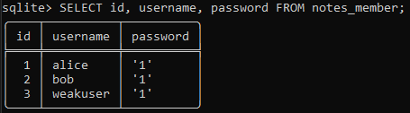

**After – PBKDF2 hashes**

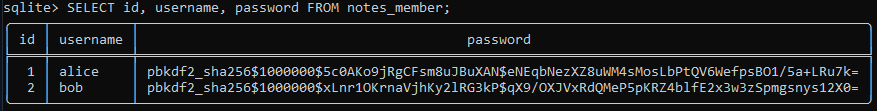

### FLAW 3 – Injection (SQL)

1. Log in as **bob**. Open **Search**.
2. In “Title contains” enter exactly:

```text
' OR 1=1 --
```

3. Click Search. The result list should include notes you should not see (e.g. alice’s private note), because the `WHERE` clause becomes always true.

**After the fix:** The same payload shows "No results."

**Before – injection returns every note**

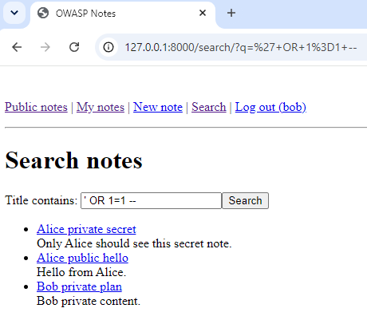

**After – same payload returns no results**

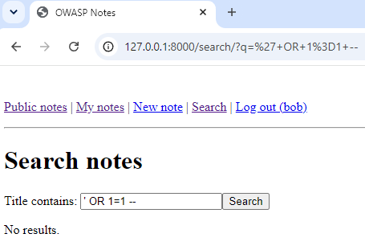

### FLAW 4 – Identification and Authentication Failures

**A. Weak password on register**

1. Open **Register**.
2. Username `weakuser`, password `1` → account is created successfully.

**B. No login throttling**

1. Open **Log in**, username `alice`, password `wrong`.
2. Submit 6+ times. You always get “Invalid username or password” and can keep trying — no lockout / no HTTP 429.

**C. Insecure session cookie**

1. Log in successfully.
2. DevTools → Application → Cookies → `http://127.0.0.1:8000`.
3. The session cookie has **HttpOnly** unchecked / false (and Secure is off; lifetime is two weeks per settings).

**After the fix:** password `1` is rejected; the 6th failed login returns **429** "Too many failed attempts. Try again in 5 minutes."; the `sessionid` cookie is HttpOnly, Secure, SameSite Strict, and expires with the session.

**Before – password `1` accepted**

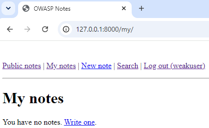

**Before – repeated failed logins still allowed**

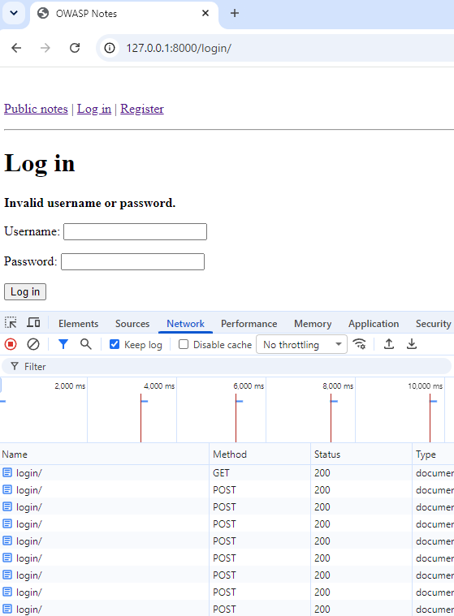

**Before – weak session cookie flags**

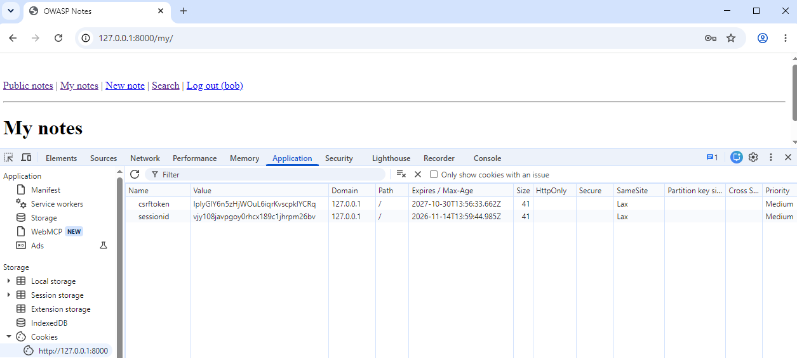

**After – weak password rejected**

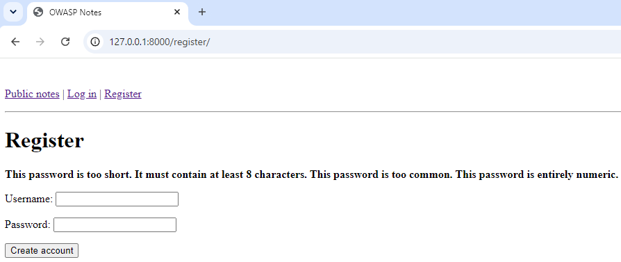

**After – lockout / HTTP 429**

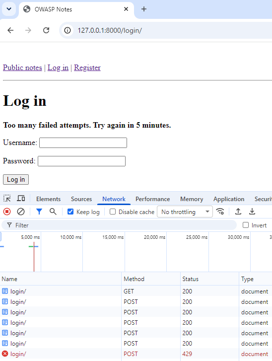

**After – hardened cookie flags**

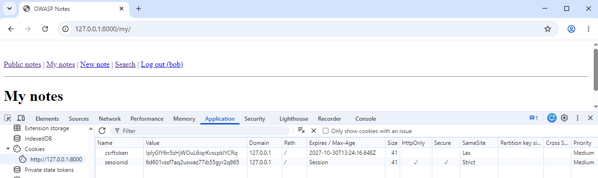

### FLAW 5 – Security Logging and Monitoring Failures

1. As **bob**, open `/note/1/`, `/note/1/edit/` and `/moderation/`; fail a few logins for `alice`.
2. Look in the project folder: there is no `security.log`.

**After the fix:** Repeat the failed login / denied access steps. `security.log` should appear with lines for those events.

**Before – no `security.log`**

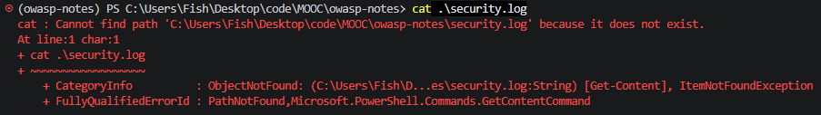

**After – `security.log` records events**

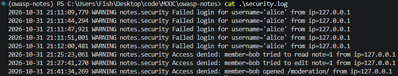
